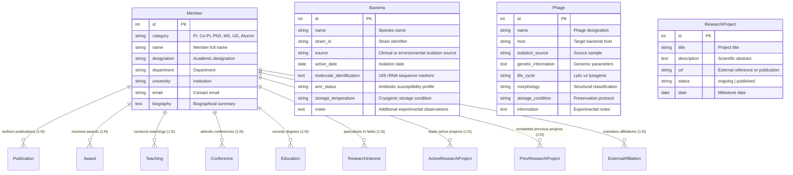

# PhageBiomeLab: Phage Bank Initiative & Laboratory Information Management System

[](https://phagebiomelab.com/)
[](https://www.python.org/)
[](https://www.djangoproject.com/)
[](https://www.sust.edu/)

---

## Abstract

Antimicrobial Resistance (AMR) is one of the most critical public health emergencies of the 21st century, rendering conventional antibiotic therapies progressively ineffective against multidrug-resistant (MDR) bacterial pathogens. Bacteriophage therapy represents a highly specific, bio-compatible alternative to traditional antibiotics. However, translational bacteriology wet-labs consistently face logistical obstacles with isolate tracking, fragmented spreadsheet archives, lack of standardized phenotypic/genotypic documentation, and an absence of unified public-facing research dissemination systems.

Here, we present **PhageBiomeLab** ([https://phagebiomelab.com](https://phagebiomelab.com)), a dedicated Laboratory Information Management System (LIMS), biological repository, and academic portal engineered for the **PhageBiome Research Group** at the **Department of Genetic Engineering and Biotechnology (GEB)**, **Shahjalal University of Science and Technology (SUST)**, Sylhet, Bangladesh. PhageBiomeLab establishes the first centralized digital infrastructure in Bangladesh dedicated to archiving clinical and environmental bacterial isolates alongside therapeutic bacteriophage banks.

Developed with Python and Django, the platform indexes characterized bacterial strains (including isolation origin, 16S rRNA sequence markers, antibiotic susceptibility patterns, and ultra-low cryogenic storage coordinates) and corresponding bacteriophage isolates (host specificity, life cycle, morphology, and genomic determinants). Complementing its biobank infrastructure, PhageBiomeLab features an integrated academic management engine with relational curricula vitae across six personnel tiers, categorized research project dissemination (ongoing investigations vs. peer-reviewed publications), a high-resolution scientific media gallery, and an automated continuous delivery pipeline for zero-downtime server synchronization.

---

## 1. Introduction

The accelerating emergence of multidrug-resistant (MDR) bacterial pathogens has severely restricted clinical treatment options, reviving global scientific interest in bacteriophages (viruses that selectively infect and lyse bacteria) as precision therapeutic agents. In Bangladesh, where antibiotic misuse and dense hospital environments drive high rates of nosocomial and community-acquired resistant infections, establishing organized biological repositories of localized bacterial hosts and therapeutic phages is essential for clinical translation.

Despite active sample collection and experimental characterization, microbiology and genomic research laboratories routinely encounter fundamental operational bottlenecks:
1. **Isolate & Metadata Fragmentation:** Critical experimental parameters—such as 16S rRNA molecular IDs, host range profiles, plaque morphologies, and cryogenic storage coordinates ($-80^\circ\text{C}$ or liquid nitrogen)—are often recorded across disconnected spreadsheets and lab notebooks, risking irreplaceable historical data loss.
2. **Biobank Traceability Disconnect:** Conventional tracking systems lack relational integrity between bacterial host strains and their targeted bacteriophages, impeding rapid candidate retrieval during phage cocktail formulation and antimicrobial susceptibility benchmarking.
3. **Academic Dissemination Bottlenecks:** Laboratories struggle to keep institutional websites synchronized with ongoing experimental projects, grant portfolios, member career trajectories, and peer-reviewed journal publications without demanding manual HTML maintenance from laboratory researchers.

To resolve these challenges, **PhageBiomeLab** was conceived, engineered, and deployed as a unified digital ecosystem connecting biobank repository management with academic portfolio presentation and public scientific communication.

---

## 2. Materials, Data Curation & Pipeline

```
+---------------------------------------------------------------------------------+
|                       Sample Collection & Isolate Biobanking                    |
|    - Clinical & environmental sampling (water bodies, hospital effluents, soil) |
|    - Host bacteria isolation, purification & cryopreservation (-80°C / LN2)     |
+---------------------------------------------------------------------------------+
                                       │
                                       ▼
+---------------------------------------------------------------------------------+
|                      Bacteriophage Screening & Characterization                 |
|    - Spot testing, double-layer plaque assays & host specificity determination  |
|    - Molecular & genomic profiling (16S rRNA sequence markers, phage genomics)  |
|    - Antimicrobial Susceptibility Testing (AST) & AMR phenotype documentation   |
+---------------------------------------------------------------------------------+
                                       │
                                       ▼
+---------------------------------------------------------------------------------+
|                        Relational Database Architecture                         |
|    - Normalized Django ORM Schema (Bacteria, Phage, Member, ResearchProject)    |
|    - Cascading academic profile relations (Publications, Awards, Grants)        |
|    - WYSIWYG rich text management (TinyMCE) & automated media optimization      |
+---------------------------------------------------------------------------------+
                                       │
                                       ▼
+---------------------------------------------------------------------------------+
|                       Web Application, Dissemination & CI/CD                    |
|    - Searchable biological repository & filterable isolate database interface   |
|    - Member directory & categorized ongoing vs. published research indexing     |
|    - Automated Git-driven webhook deployment pipeline (zero-downtime builds)    |
+---------------------------------------------------------------------------------+
```

### 2.1 Biological Standardization & Data Protocols
The repository adheres to strict wet-lab and computational curation protocols:
- **Taxonomic & Host Range Verification:** Bacterial hosts are classified by canonical binomial nomenclature, clinical/environmental isolation source, and specific strain IDs. Phage records explicitly define host range and target bacterial species.
- **Molecular & Genomic Identification:** Bacterial isolates incorporate 16S rRNA sequence data for molecular verification, while phage records index life cycle (lytic vs. lysogenic), structural morphology, and genomic parameters.
- **Antimicrobial Resistance (AMR) Profiling:** Host bacteria are documented with antibiotic susceptibility patterns, enabling cross-comparison between phenotypic resistance and phage lysis susceptibility.
- **Cryogenic Storage Auditing:** Every specimen record maintains cryogenic location and preservation parameters ($-80^\circ\text{C}$ / liquid nitrogen) to guarantee physical sample retrieval.

### 2.2 Data Statistics & Repository Dimensions

| Dimension / Entity | Model / Implementation | Functional Role in Repository |
|:---|:---:|:---|
| **Bacterial Isolates** | `Bacteria` | Clinical, reference, and environmental host strain records |
| **Bacteriophage Biobank** | `Phage` | Characterized phage isolates with host range and morphology |
| **Research Group Personnel** | `Member` | Categorized directory across 6 academic hierarchy tiers |
| **Academic Credentials** | 9 Relational Sub-Models | Publications, Awards, Grants, Teaching, Conferences, Education |
| **Research Investigations** | `ResearchProject` | Dual-indexed ongoing lab projects & published journal articles |
| **Scientific Media Gallery** | `Gallery` & `ImageContent` | High-resolution electron microscopy, fieldwork, and lab infrastructure |

---

## 3. Database Schema & System Architecture

PhageBiomeLab is implemented with **Django 5.1 (Python 3.10+)** following the Model-View-Template (MVT) design pattern with normalized relational database models.

### 3.1 Entity-Relationship Model



### 3.2 Key Architecture & Query Optimization Strategies
- **Normalized Relational Data Governance:** Database schema guarantees referential integrity through cascading foreign keys across member academic milestones, preventing orphaned records.
- **Relational CV Assembly:** Custom template context builders aggregate all nine academic dimensions for each researcher, generating full curriculum vitae without repetitive querying.
- **Asset Pipeline & Optimization:** Static assets are served and compressed via **WhiteNoise** with persistent HTTP caching headers, while user-uploaded media (micrographs, headshots) undergo automated image compression via **Pillow**.
- **In-Browser WYSIWYG Scientific Editing:** Integrated **django-tinymce** allows laboratory curators to compose structured research descriptions, insert scientific terminology, and format abstracts directly within the administrative portal.

---

## 4. Web Interface & Core Capabilities

The live platform is deployed at [https://phagebiomelab.com](https://phagebiomelab.com) with the following core modules:

1. **Biological Biobank & Repository Explorer:** Filterable public interface allowing researchers to inspect characterized bacterial strains and therapeutic bacteriophages with host specificity and AMR profiles.
2. **Academic Portfolio & Personnel Directory:** Granular researcher profiles structured by academic seniority (Principal Investigators, Co-investigators, PhD Researchers, MS Students, Undergraduates, and Alumni), complete with relational publications, honors, and active grants.
3. **Dynamic Research Dissemination Engine:** Real-time cataloging that categorizes laboratory investigations into **ongoing projects** (with objectives, methodologies, and status) and **peer-reviewed publications** (with direct DOI hyperlinks).
4. **Interactive Scientific Media Gallery:** Responsive media showcase displaying laboratory instrumentation, electron and fluorescence microscopy imagery, and field sampling activities.

---

## 5. Installation, Deployment & Local Setup

### 5.1 Prerequisites
- **Python:** 3.10, 3.11, or 3.12
- **Database Engine:** SQLite3 / PostgreSQL / MySQL
- **Git**

### 5.2 Environment Setup
```bash
# 1. Clone the repository
git clone https://github.com/Soash/PhageBiomeLab.git
cd PhageBiomeLab/project

# 2. Initialize and activate a virtual environment
python -m venv venv
# On Windows (PowerShell):
.\venv\Scripts\Activate.ps1
# On Unix/macOS:
source venv/bin/activate

# 3. Install dependencies
pip install -r requirements.txt
```

### 5.3 Configuration & Database Initialization
Create a `.env` file within the `project/` directory:
```ini
ENVIRONMENT=development
SECRET_KEY=your-secure-django-secret-key-here
DEBUG=True
```

Execute schema migrations and administrative setup:
```bash
# Apply database migrations
python manage.py migrate

# Create administrative superuser account
python manage.py createsuperuser

# Launch local development server
python manage.py runserver
```
Visit `http://127.0.0.1:8000/` in your browser. Access the administrative portal at `http://127.0.0.1:8000/admin/`.

### 5.4 Production Webhook Deployment
The production deployment on Linux/cPanel utilizes an automated Git webhook sequence:
1. Pushing commits to the `main` branch triggers the remote webhook listener (`deploy.php`).
2. The deployment sequence (`deploy.sh`) pulls updates, applies schema migrations, and collects static assets:
```bash
git pull origin main
python manage.py migrate --noinput
python manage.py collectstatic --noinput
```

---

## 6. Project Team & Acknowledgements

The development and maintenance of **PhageBiomeLab** is conducted under the guidance and leadership of the faculty and researchers at the **Department of Genetic Engineering and Biotechnology (GEB)**, **Shahjalal University of Science and Technology (SUST)**.

### Project Leadership
- **Principal Investigator & Project Supervisor:** [Prof. Dr. Md. Shakhinur Islam Mondal, PhD](https://phagebiomelab.com/member/6/)  
  *Professor, Department of Genetic Engineering and Biotechnology (GEB), Shahjalal University of Science and Technology (SUST), Sylhet, Bangladesh*
- **Full-Stack Architect & Lead Developer:** [Md Abu Sadat Soash](https://soash.github.io/) ([@Soash](https://github.com/Soash))  
  *Department of Genetic Engineering and Biotechnology, Shahjalal University of Science and Technology (SUST), Sylhet, Bangladesh*
- **Co-Developer:** Mutashim Ahammed Rafi

### Laboratory Research Group
Special recognition is extended to all postgraduate fellows, research associates, and undergraduate investigators at the **PhageBiome Research Group** participating in sample collection, phage isolation, AMR characterization, and repository curation.

---

## 7. Citation

If you utilize data, isolates, or software architecture from the PhageBiomeLab platform in your scientific research or academic publications, please cite the repository as follows:

```bibtex
@article{PhageBiomeLab2026,
  title   = {PhageBiomeLab: Phage Bank Initiative and Laboratory Information Management System},
  author  = {Mondal, Md. Shakhinur Islam and Soash, Md Abu Sadat and Rafi, Mutashim Ahammed and {PhageBiome Research Group}},
  journal = {Department of Genetic Engineering and Biotechnology, Shahjalal University of Science and Technology},
  year    = {2026},
  url     = {https://phagebiomelab.com/}
}
```

---

## 8. Inquiries & Correspondence
- **Principal Platform:** [https://phagebiomelab.com](https://phagebiomelab.com)
- **Host Institution:** [Shahjalal University of Science and Technology (SUST)](https://www.sust.edu/)
- **Department:** [Department of Genetic Engineering and Biotechnology (GEB)](https://www.sust.edu/departments/geb)
- **Principal Investigator Profile:** [Prof. Dr. Md. Shakhinur Islam Mondal](https://phagebiomelab.com/member/6/)
- **Technical Inquiries & Repository Maintenance:** [Md Abu Sadat Soash](https://github.com/Soash)
